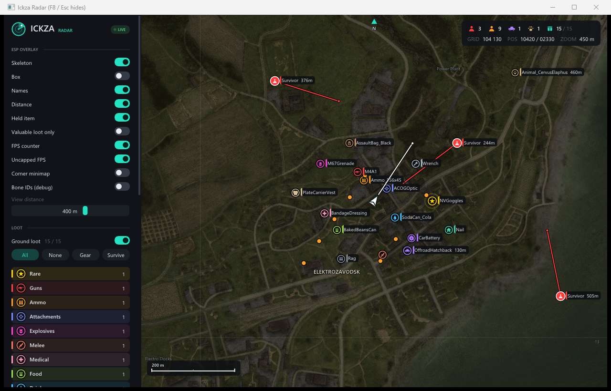
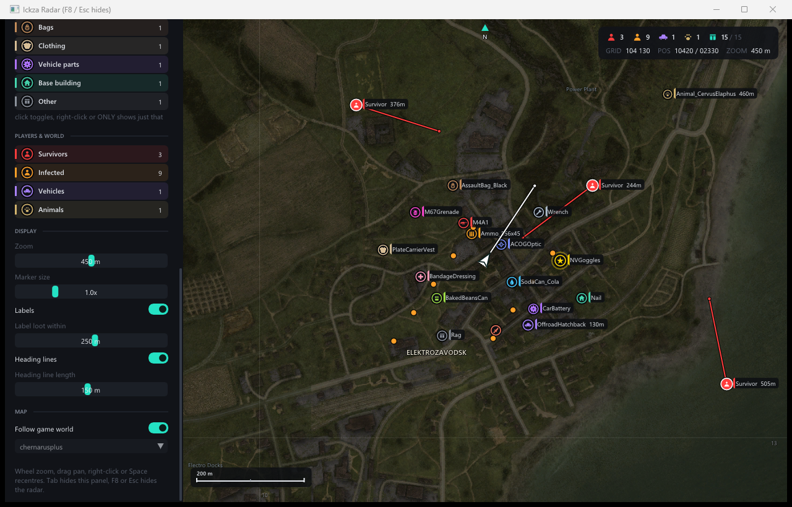
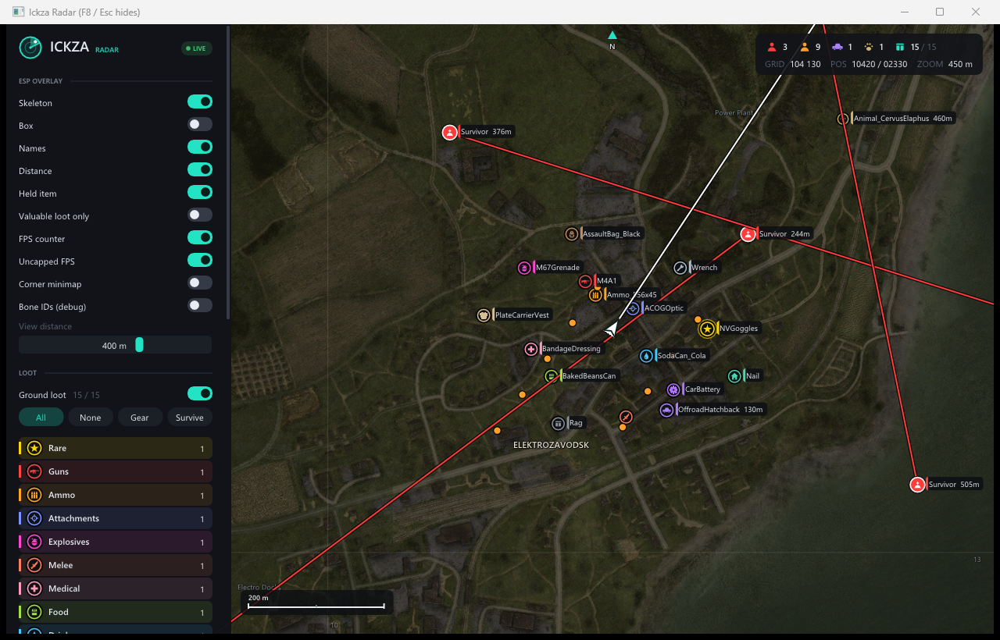
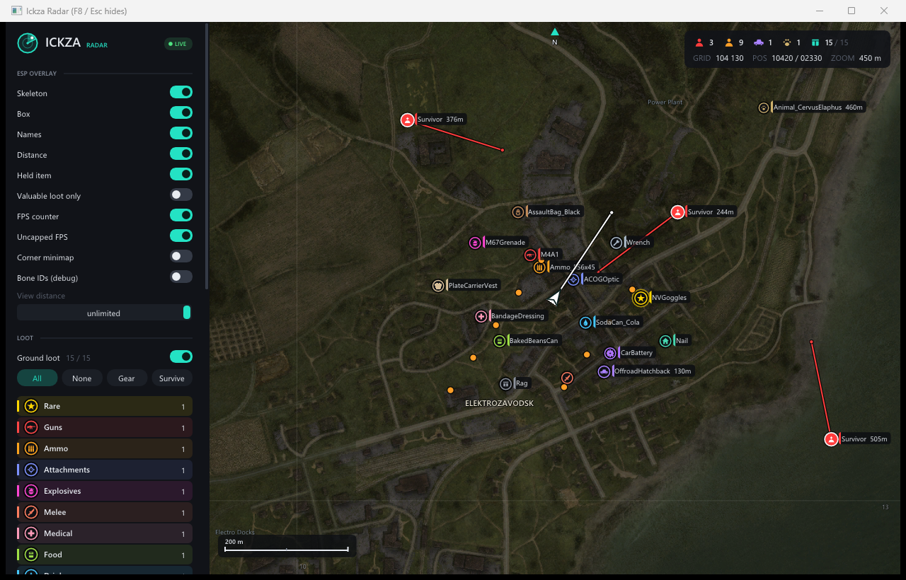

# Ickza

A DayZ ESP and radar that reads game memory over **DMA**. The game runs on the gaming PC; the DMA card
and Ickza run on a second machine (a laptop), and its fullscreen output is merged onto the gaming PC's
screen through a fuser. Nothing runs on the gaming PC.



| Radar settings | Heading lines | Box ESP, unlimited range |
|---|---|---|
|  |  |  |

Read the short write-up: [Building Ickza](docs/BLOG.md).

## Features

**ESP overlay**
- Skeleton or box ESP
- Real player names from the server's player list (not the character model), plus distance
- Item in hand for every player, including you
- Zombies on/off, and a valuable-loot-only mode
- Adjustable view distance (25–900 m, or unlimited) and crosshair size
- Optional corner minimap, FPS counter and uncapped FPS
- Direct3D 11 renderer with a GDI fallback (`--gdi`)

**Radar**
- Survivors, infected, animals, vehicles and loot, each one toggleable
- **Online players list**: everyone on the server in a searchable dropdown, with you first, then players
  near you with their distance, then everyone else A–Z
- 15 loot categories (guns, ammo, attachments, medical, food, base building, rare…) with their own colours
- One-click presets (All / None / Gear / Survive); right-click a category to show only that one
- Item filter: blacklist or whitelist by classname with `*` wildcards, suggestions from loot in range,
  and `F` on a hovered item adds it; plus `dayz_rare.txt` for items to always highlight
- Live counts of survivors, infected, vehicles, animals and loot, with grid reference and position
- Heading lines, player names, loot labels within a set range, adjustable marker size
- Mouse wheel or `+` / `-` zooms, drag pans, right-click or `Space` re-centres, `Tab` hides the side
  panel, `F8` or `Esc` hides the radar
- Detects the current map and downloads it on first use (from dayz.xam.nu): satellite or topographic,
  8192 px or 16384 px, plus town names

**Control panel**
- Pick the output display, with an "Identify" button to tell the screens apart
- Start / stop, with live game PID, server and DMA link speed
- Settings saved to `Ickza.ini`

**Under the hood**
- Reads the game PC's physical memory map over DMA and caches it (`mmap.txt`)
- Updates itself: `deploy.bat` drops a new build next to the running one and it restarts into it
- Crash lines in `Ickza.log` decode against `build\Ickza.map`

## Hardware

- A PCIe DMA card (FPGA, LeechCore-supported) in the gaming PC, connected by USB to the second machine
- A second Windows 10/11 machine to run Ickza
- A fuser or capture setup to put the second machine's output on the gaming PC's monitor

## Quick start (no build needed)

1. Download the latest build from the release thread and unzip it on the second machine.
2. Install the FTDI D3XX driver if Windows doesn't pick up the DMA card.
3. Double-click `run_ickza.bat`. `END` quits.

The release zip already holds the MemProcFS / LeechCore / FTDI DLLs in `dma\`.

Command line: `Ickza [--local | --dma] [--device fpga] [--dma-dir dir] [--fullscreen] [--monitor n|WxH] [--gdi] [--loot] [--radar] [--map name]`

## Building from source

Requires Visual Studio 2022 or newer with the **Desktop development with C++** workload.

1. Put the runtime DLLs in `dma\` (`vmm.dll`, `leechcore.dll`, `leechcore_driver.dll`, `info.db`,
   `FTD3XX.dll`, `FTD3XXWU.dll`, `dbghelp.dll`, `symsrv.dll`; see [THIRD_PARTY.md](THIRD_PARTY.md)).
2. From PowerShell: `& .\build.bat x64`, or open `Ickza.sln`.

`build\` is then a complete, runnable folder. `package.bat` zips it for a release, and
`deploy.bat <laptop>` pushes it to a `\\<laptop>\acesp` share. Set up the share once, in an admin
PowerShell on the laptop (the network must be Private):

```
mkdir C:\acesp
New-SmbShare -Name acesp -Path C:\acesp -ChangeAccess $env:USERNAME
```

## Compatibility & troubleshooting

Built for **DayZ 1.30**. Game updates move the World offset, so a new DayZ patch needs a new Ickza release.

| Problem | Fix |
|---|---|
| Players show as Elias, Seth… (character models) | The NetworkClient offset (`kNetClient` in `src\esp.cpp`) is out of date. |
| "MemProcFS init failed" | Something else has the card open (another Ickza, pcileech…). Close it, or replug the card. |
| Radar stuck on "waiting for DayZ" | DayZ was updated: wait for a new release, or see below. Also check you are in a game, not the menu. |
| "vmm.dll not found" | Keep the `dma\` folder next to `Ickza.exe` (unzip the whole release, not just the exe). |
| DMA card not found | Install the FTDI D3XX driver, use a USB 3 port, and check the card's own firmware/tools see it. |
| Map stays blank | The PC running Ickza needs internet the first time each map is used. |
| Wrong screen | Pick the display in the control panel ("Identify" shows which is which). |

## After a DayZ update

If the radar sits on "waiting for DayZ", the World offset has moved. Find the new one, set `kWorld` in
`src\esp.cpp`, rebuild and redeploy.

## Layout

| Path | What |
|---|---|
| `src\` | Source. `src\imgui\` is Dear ImGui (radar screen). |
| `third_party\pcileech\` | MemProcFS / LeechCore headers. `vmm.dll` is loaded at runtime. |
| `laptop\` | `run_ickza.bat` and the loot lists (`dayz_rare.txt`, `dayz_loot_cats.txt`). |
| `docs\` | Write-up and screenshots. |

## Disclaimer

This is a personal research project into DMA memory reading. Using it in online games breaks their terms
of service and can get your account banned. Use it at your own risk.

## Licence

[AGPL-3.0](LICENSE), because Ickza is built on MemProcFS and LeechCore. Third-party credits are in
[THIRD_PARTY.md](THIRD_PARTY.md).
